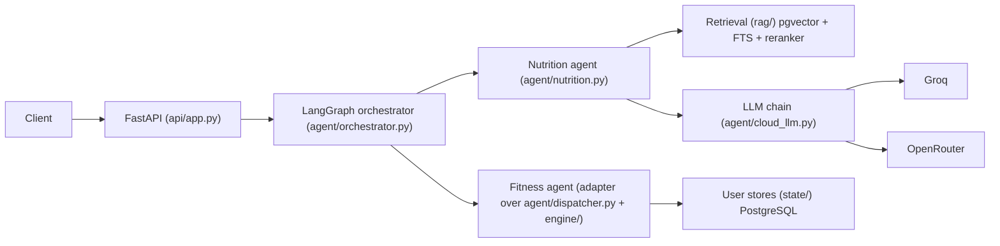
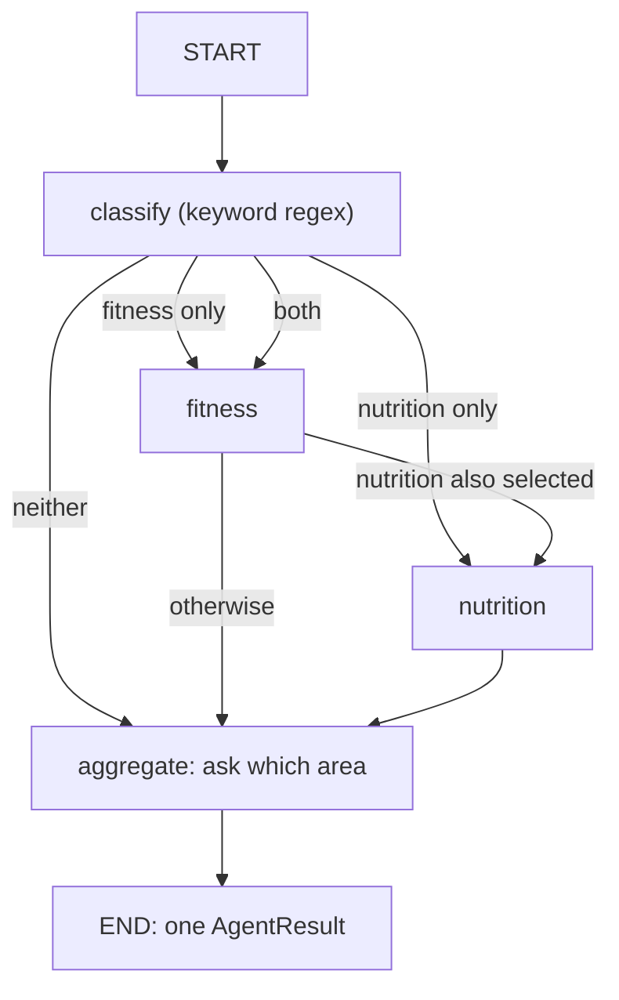

# Training Agent API

A fitness and nutrition coaching system. A LangGraph orchestrator routes each chat message to a workout agent, a citation-enforcing nutrition RAG agent, or both. A multi-provider LLM fallback chain generates the answers. The repository also contains the evaluation harness used to measure each part, including its known limitations.

- **Stack:** Python 3.10–3.13, FastAPI, LangGraph, PostgreSQL + pgvector (Neon), fastembed
- **Live API:** https://training-agent-api.fastapicloud.dev (health: `/health`, readiness: `/ready`)
- **Entry point:** `api.app:app` (declared in `pyproject.toml`)

## Contents

1. [Architecture](#architecture)
2. [Multi-agent orchestration](#multi-agent-orchestration)
3. [Nutrition agent and RAG pipeline](#nutrition-agent-and-rag-pipeline)
4. [LLM fallback chain](#llm-fallback-chain)
5. [API surface](#api-surface)
6. [Repository layout](#repository-layout)
7. [Getting started](#getting-started)
8. [Evaluation](#evaluation)
9. [Testing and CI](#testing-and-ci)
10. [Known limitations](#known-limitations)

## Architecture



## Multi-agent orchestration

The graph (`agent/orchestrator.py`) owns routing and result aggregation. The domain agents stay independent and talk to the orchestrator only through validated Pydantic contracts.



- **Routing is deterministic.** `classify_request` matches fitness and nutrition keyword patterns. A message that matches both runs the fitness agent first and then the nutrition agent, in sequence. A message that matches neither gets a clarification question.
- **Contracts** (`agent/contracts.py`):
  - `AgentRequest`: `request_id`, `user_id`, `message` (max 1000 characters), optional `profile`, optional `today`.
  - `AgentResult`: `agent`, `status`, `message` (max 4000 characters), up to 20 `EvidenceReference` items, and a `metadata` dict.
  - `AgentStatus`: `ok`, `needs_clarification`, `refused`, `unavailable`, `error`.
- **Agent interface** (`agent/interfaces.py`): a `DomainAgent` protocol with a `name` and a `run(request) -> AgentResult` method. Transport concerns such as A2A, HTTP or queues are deliberately kept out of it.
- **Fitness agent:** `FitnessAgentAdapter` wraps the existing dispatcher. It maps the legacy statuses (`needs_info`, `confirm`, `safety_caution`, `safety_urgent`, `out_of_scope`, and so on) onto `AgentStatus`. Any exception becomes `unavailable`. User stores are passed in through a closure, so no database handles go through the LLM or between agents.
- **Aggregation:** with one result, that result is returned. With two, the messages are combined under "Fitness:" and "Nutrition:" headings and the evidence is merged (capped at 20). The combined status is `ok` only if both are `ok`, `unavailable` if either is, and `needs_clarification` otherwise.
- **Per request:** `run_chat` in `api/app.py` builds the orchestrator for each authenticated request with that user's fitness handler and the shared LLM.

MCP and A2A are not implemented. The design documents in `docs/architecture/` defer both until agents become separately deployed services.

## Nutrition agent and RAG pipeline

**Retrieval** (`rag/nutrition_retrieval.py`, SQL in `sql/`):

- The nutrition corpus lives in its own table, `nutrition_knowledge` (550 chunks), separate from the fitness knowledge table.
- Embeddings: `BAAI/bge-small-en-v1.5` via fastembed. Indexes: pgvector HNSW on the embedding, a full-text (tsvector) index, and a source index.
- Modes: vector-only, hybrid with reciprocal rank fusion (RRF), and hybrid plus cross-encoder reranking. The reranker (`Xenova/ms-marco-MiniLM-L-6-v2`) runs as a standalone service in `services/nutrition_reranker/`. If it is unavailable, retrieval falls back to RRF order.
- Ingestion (`nutrition_ingestion/`): PDF extraction, chunking and persistence. Install the optional `ingestion` extra to use it.

**Answering** (`agent/nutrition.py`):

1. Retrieve up to 5 chunks (from 30 candidates) and build a context capped at 9,000 characters.
2. Prompt the LLM to answer only from that evidence and to cite every factual claim with the supplied labels (`[S1]`, `[S2]`, ...).
3. Validate the reply. It must contain at least one label, and every label must be one that was supplied. Grouped labels such as `[S1, S3]` are expanded first.
4. If validation fails, retry once with a corrective instruction.
5. A short, number-free reply saying the sources are insufficient returns status `refused` (`insufficient_evidence`). Two failed attempts return `unavailable` with a fixed message. An uncited answer is never returned.

Each result carries `citation_validation`, `citation_attempts`, `citation_sources` and `served_by` (the provider and model that answered each attempt).

## LLM fallback chain

`agent/cloud_llm.py` and `agent/model_registry.py` implement a priority-ordered chain of three models across two providers:

| Priority | Provider | Model |
|---|---|---|
| 1 | Groq | `qwen/qwen3.8-27b` |
| 2 | OpenRouter | `nvidia/nemotron-3-ultra-550b-a55b:free` |
| 3 | Groq | `openai/gpt-oss-20b` |

- **Cooldowns:** 429 puts a model on a 60 s cooldown and 5xx on 45 s. 401/403 puts the whole provider on 300 s. Other errors such as timeouts use 300 s. A truncated, empty or invalid-JSON reply moves to the next model without a cooldown.
- **Limits:** a 30 s overall deadline, per-call timeouts (default 8 s, capped by each model's configured timeout), and a 400–800 token reply budget.
- **Privacy:** health-limitation text is redacted before cloud calls unless `CLOUD_SHARE_LIMITATIONS=1`. Replies are cached for 6 hours (up to 500 entries), but never for prompts that carry profile facts.
- **Modes:** `LLM_MODE=cloud` (default) uses `CloudOnlyLLM`, which raises `LLMUnavailable` when every model fails. `LLM_MODE=local` uses `HybridLLM` with a local model. In hybrid mode, streaming, structured and profile-bearing requests stay local.

## API surface

The app defines 35 routes in `api/app.py`. Interactive docs are available at `/docs` when the server is running.

| Area | Routes |
|---|---|
| Health | `GET /health`, `GET /ready` |
| Auth | `POST /v1/auth/register`, `/login`, `/refresh`, `/logout` |
| Chat | `POST /v1/chat`, `/v1/chat/stream`, `/v1/chat/confirm` |
| Profile and account | `GET`/`PUT /v1/profile`, `GET /v1/account/export`, `DELETE /v1/account` |
| Sync | `GET`/`POST /v1/sync` |
| Exercises | `GET /v1/exercises`, `/v1/exercises/{id}`, `/v1/exercises/{id}/alternatives`, `/v1/clips/{name}`, `/v1/thumbs/{name}`, `/v1/meta` |
| Programs and sessions | `POST`/`GET /v1/program`, `GET /v1/program/explain`, `POST /v1/program/swap`, `GET /v1/today`, `POST /v1/session/finish`, `/skip`, `/undo` |
| Progress | `GET /v1/history`, `/v1/history/exercise/{id}`, `/v1/progress/targets`, `/v1/progress/weekly`, `/v1/reminders` |
| Safety | `POST /v1/safety/check` |

Three internal evaluation routes (`/internal/evaluation/...`) are hidden from the schema and disabled unless `EVALUATION_API_KEY` is configured. Callers send it in the `X-Evaluation-Key` header.

`POST /v1/chat/stream` runs the full chat request first and then streams the finished reply.

## Repository layout

```text
agent/                orchestrator, contracts, nutrition agent, fitness adapter, dispatcher, LLM chain
api/                  FastAPI app, auth, internal evaluation routes
engine/               deterministic workout engine (programs, progression, swaps, safety checks, ...)
rag/                  retrieval: hybrid search, nutrition retrieval, local index
nutrition_ingestion/  PDF extraction, chunking and persistence for the nutrition corpus
services/             standalone nutrition reranker service
state/                per-user stores (profile, programs, history, accounts) on PostgreSQL
evaluation/           ranking metrics, resume-metric evaluators, labelled datasets (evaluation/datasets/)
scripts/              benchmark and live-evaluation scripts
sql/                  nutrition knowledge schema and indexes
tests/                29 test modules
docs/architecture/    module design notes, including multi-agent architecture
data/                 exercise media (clips, thumbnails) and other bundled data
```

## Getting started

```bash
python -m venv .venv
source .venv/bin/activate          # Windows PowerShell: .\.venv\Scripts\Activate.ps1
pip install -e ".[ingestion,test]"
cp .env.example .env               # then fill in the values
uvicorn api.app:app --reload
```

Settings are listed in `.env.example`. The ones that matter most for chat and nutrition are:

- `NEON_DATABASE_URL`: the PostgreSQL connection for retrieval.
- `GROQ_API_KEY` and `OPENROUTER_API_KEY`: the cloud model keys.
- `LLM_MODE`: `cloud` (default) or `local`.
- `EVALUATION_API_KEY`: enables the internal evaluation routes.

Never commit `.env`. A key already exported in your shell can take precedence over `.env`, so keep the two consistent.

Deployment notes are in [DEPLOYMENT.md](DEPLOYMENT.md).

## Evaluation

Datasets live in `evaluation/datasets/` and are synthetic and labelled. They are meant to be reviewed by a human before any score is published. More detail is in [EVALUATION.md](EVALUATION.md).

### Deterministic components

| Suite | Cases | Result |
|---|---|---|
| Routing (held-out set) | 40 | 35/40 (87.5%) |
| Workout constraints | generated plans | 90/90 with zero hard-constraint violations |
| Progression rules | 14 | 14/14 |
| Safety rules (red-team set) | 35 | 35/35 |

The safety suite checks the deterministic backend rules. It does not measure how well the LLM refuses.

### Nutrition retrieval

42 labelled queries, k = 5, with relevance labels as human-reviewed chunk IDs from the dataset. The reranked row was measured with a locally hosted reranker. Latency is retrieval only, measured from a development machine against the hosted database, so it is not end-to-end API latency.

| Mode | Recall@5 | MRR@5 | nDCG@5 | Hit@5 | Latency p50 / p95 |
|---|---|---|---|---|---|
| Vector only | 0.702 | 0.710 | 0.613 | 0.976 | 2.9 s / 3.9 s |
| Hybrid (RRF) | 0.639 | 0.603 | 0.531 | 0.905 | 3.3 s / 4.0 s |
| Hybrid + reranker | 0.683 | 0.736 | 0.624 | 0.929 | 5.6 s / 6.9 s |

On this dataset, naive RRF fusion underperformed vector-only, and the reranker recovered it to a slightly higher MRR. Reranking also roughly doubled median latency and lowered Hit@5 compared with vector-only.

### Live nutrition answers (deployed API)

42 synthetic queries against the deployed API. "Citation-valid" means the answer contained valid in-scope citation labels. It does not mean the cited sources support the claims.

| Run | Request pacing | State | Citation-valid |
|---|---|---|---|
| A | 3 s | before cooldown fix | 16/42 |
| B | 20 s | before cooldown fix | 34/42 |
| C | 20 s | after cooldown fix | 39/42 |
| D | 20 s | after fix, with model provenance | 37/42 |

An earlier run, before diagnostics were added, scored 21/42.

- **What the fix changed:** before it, a truncated model reply put that model on a 5-minute cooldown. A few of those could lock out all three models, so failures arrived in blocks of up to 7 consecutive cases with no model request sent. After the fix, failures were isolated single cases.
- **Failure modes after the fix:** run C's three failures were `missing_citation` (a model answered without citations twice). Run D's five failures were `LLMUnavailable`.
- **Who answered in run D:** Groq qwen answered 27 of 42 cases, OpenRouter 7, Groq gpt-oss 4, and 4 cases reached no model.
- **Small probe:** in a 3-samples-per-model replay of the prompts for three cases, gpt-oss-20b returned an uncited or empty reply in 3 of 9 samples, while the other two models returned usable replies each time.

### Running the live evaluation

The runner does not read `.env`, so export the key in your shell first:

```bash
export EVALUATION_API_KEY=...      # PowerShell: $env:EVALUATION_API_KEY = "..."
python scripts/run_live_resume_evaluation.py \
  --base-url https://training-agent-api.fastapicloud.dev \
  --output artifacts/evaluation/my-run.json \
  --skip-retrieval --max-nutrition-cases 42 --pause-seconds 20
```

Use a new `--output` for each run. `--resume` continues from a checkpoint, but it treats `unavailable` rows as complete. `--interactive-review` walks through the answers for hand review of citations and factual support.

## Testing and CI

```bash
python -m pytest -q
```

- 169 tests pass locally with `tests/test_nutrition_benchmark.py` excluded. That module failed to import in my local environment (`scripts.benchmark_nutrition_retrieval` was not found), so check it in yours.
- Line coverage was 46% overall across `agent`, `api`, `engine`, `rag`, `services` and `state`. It was 97–99% on the orchestrator and nutrition agent.
- GitHub Actions (`.github/workflows/python-ci.yml`) runs on Python 3.10–3.13: compile check, import check for the app and reranker service, tests with coverage, and artifact uploads for the nutrition ingestion, retrieval-contract and orchestration reports.

## Known limitations

- **Citation validity is not factual support.** The automated check confirms labels, not that the cited text supports each claim. Factual support still needs human review.
- **Live results vary between runs** (16/42 to 39/42 so far), mainly with free-tier provider availability and pacing. Why qwen answered only 27 of 42 cases in the last run has not been root-caused.
- **The reranker in production is unconfirmed.** The retrieval numbers above come from a local reranker. A separate run with no reranking available fell back to RRF for all 42 queries.
- **Routing is keyword-based.** It missed 5 of 40 held-out queries. Mixed queries run the two agents in sequence, not in parallel.
- **Mixed-agent status:** when one agent returns `refused` or `error` and the other `ok`, the combined status becomes `needs_clarification`.
- **Coverage is uneven:** several engine modules had no test coverage in the measured run.
- **MCP and A2A are design notes, not features.**
